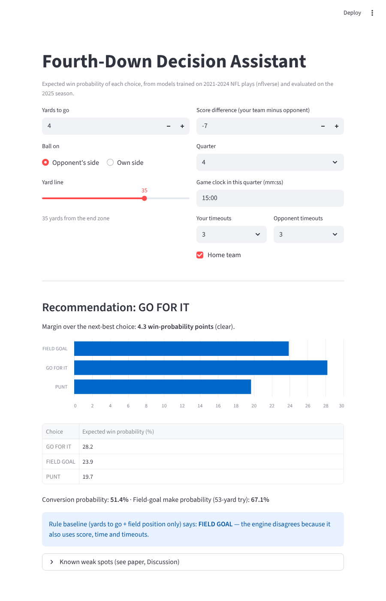

# NFL Fourth-Down Decision Assistant

Recommends **go for it, field goal, or punt** on an NFL fourth down by estimating the expected
win probability (WP) of each choice. Trained on 2021-2024 and evaluated on the held-out 2025 season
against a simple rule and against the public nfl4th engine.

Author: Seth Williams (COMP 365, North Carolina A&T State University, Fall 2026)



---

## 1. Quick start (exact reproduction, about 1 minute)

```bash
git clone <this repository URL>
cd nfl-fourth-down-assistant
python3.13 -m venv .venv
source .venv/bin/activate            # Windows: .venv\Scripts\activate
pip install -r requirements.txt
bash reproduce.sh                    # Windows without bash: see section 3
```

`reproduce.sh` trains every model, runs every test, regenerates every table and figure, and
runs `verify_results.py`, which compares all reported values with `expected/expected_results.json`.
A successful run ends with:

```
[OK] data snapshot SHA-256
[OK] 803/803 reported values reproduced
ALL RESULTS REPRODUCED
```

## 2. Requirements

| Item | Used for the reported results |
|---|---|
| Python | 3.13.16 |
| Python packages | scikit-learn 1.8.0, pandas 3.0.6, numpy 2.5.3, matplotlib 3.11.2, joblib 1.6.0 (pinned in `requirements.txt`) |
| Demo only | streamlit 1.50.0 (`requirements-demo.txt`) |
| External benchmark only (optional) | R 4.3.3, nfl4th 1.0.7, nflfastR 6.0.0, xgboost (R) 3.2.1.1, data.table >= 1.15 |
| Hardware | 2 vCPU (Intel Xeon 2.1 GHz), 8 GB RAM, no GPU. Peak memory about 0.43 GB |
| Runtime | about 50 seconds for the full Python build; about 2 minutes for the nfl4th script |
| Randomness | Fixed seed 365 for every model, CV split and bootstrap. Repeated builds give byte-identical `results.json` |

**The scikit-learn version matters.** With scikit-learn 1.9.1 the gradient-boosting results shift
slightly and `verify_results.py` reports mismatches. Use the pinned versions.

## 3. Step by step (what `reproduce.sh` runs)

```bash
python fourth_down.py build        # train + evaluate; writes everything to results/
python verify_results.py           # compare results/results.json with expected/expected_results.json
python fourth_down.py predict --ydstogo 4 --yardline_100 35 --score_diff -7 --qtr 4 --seconds_left 900
python make_results_md.py          # regenerate RESULTS.md (every reported number, as tables)
python tune_wp.py                  # optional, 5-8 min: grouped CV that chose the WP model settings
```

`predict` options: `--ydstogo`, `--yardline_100` (yards from the opponent's goal line),
`--score_diff` (offense minus defense), `--qtr`, `--seconds_left` (seconds left in the **game**),
`--timeouts`, `--opp_timeouts`, `--home` (1 or 0). It uses the final engine.

### Interactive demo

```bash
pip install -r requirements-demo.txt
streamlit run app.py               # opens http://localhost:8501
```

### External benchmark (optional; its output is already in `data/`)

```bash
python fourth_down.py build --source nflverse    # downloads data/pbp_2021..2025.csv.gz (~95 MB)
Rscript benchmark_nfl4th.R                         # writes data/nfl4th_2025_recommendations.csv
```

Install nfl4th from CRAN (`install.packages("nfl4th")`). If the nflverse schedule download is
blocked on your network, clone `https://github.com/nflverse/nfldata` and run
`NFLDATA_GAMES=nfldata/data/games.rds Rscript benchmark_nfl4th.R`.

## 4. Data

**Source:** nflverse play-by-play, 2021-2025
(<https://github.com/nflverse/nflverse-data/releases/tag/pbp>), licensed
[CC BY 4.0](https://creativecommons.org/licenses/by/4.0/). Credit: the nflverse project.

**Frozen snapshot (default).** `data/snapshot/nflverse_pbp_2021_2025_subset.csv.gz` (8 MB) holds the
26 columns this project uses for all 247,284 plays, from files downloaded on 2026-10-08.
`data/snapshot/SHA256SUMS.json` records the SHA-256 of each original season file and of the snapshot.

**Cleaning.** Fourth downs with play type run, pass, punt or field goal (run/pass = "go"); rows
missing a feature and 2 go plays without a result are dropped: 20,267 decisions (10,994 punts,
5,100 field goals, 4,173 go attempts). Decision tests use the 3,973 regulation fourth downs of 2025.

**Splits and leakage control.** Everything is fit on 2021-2024; 2025 is used only for tests.
Conversion models: leave-one-season-out CV within 2021-24. WP settings: 5-fold CV grouped by game
within 2021-24 (`tune_wp.py`). nflverse's `wp`/`wpa` columns are never model inputs; they only score
outcomes.

## 5. Models and engines

All models are trained from scratch with scikit-learn; no pretrained models.

| Component | Model | Settings |
|---|---|---|
| Conversion baselines | League rate; rate by yards to go (1-9, 10+) | 2021-24 means |
| Conversion, learned | Logistic regression; random forest; gradient boosting (5 features*) | RF 400 trees, leaf 25; GB 200 iters, depth 3, leaf 40, monotonic in yards to go |
| Conversion used by engine | Spline logistic regression on yards to go + field position | 4 knots, degree 2, C 0.5 |
| Sparse-region fix | Logit shift toward observed 2021-24 rate for own 15 or deeper, shrunk by n/(n+50) | n = 27 attempts |
| WP v1 (checkpoint) | HistGradientBoosting, monotonic | 10 features; 200 iters, lr 0.05, depth 3, leaf 1000, L2 1.0 |
| WP v2 (final) | v1 + red-zone, goal-to-go, log distance, late-game score features | 17 features; 300 iters (config v2b in `tune_wp.py`) |
| Field goal | Logistic regression on kick distance | FG > 63 yards unavailable |
| Punt / kickoff / conversion gain | Empirical 2021-24 tables | |

\*yards to go, yards from goal, score difference, quarter, seconds left in game.

| Engine | Conversion | WP | Sparse fix | Role |
|---|---|---|---|---|
| `final` | situation-neutral | v2 | yes | default (predict, app, headline results) |
| `checkpoint` | situation-neutral | v1 | no | engine reported at Checkpoint 2 |
| `wp_fix_only` | situation-neutral | v2 | no | ablation |
| `full_conv` | 5-feature LR | v2 | no | ablation |

Recommendation = highest expected WP. Margin labels everywhere: toss-up < 1 WP point, lean 1-3, clear >= 3.

## 6. Evaluation (all on 2025)

| Test | Cases | Measure |
|---|---|---|
| T1 Conversion | 931 go attempts, 274 games | Accuracy, ROC-AUC, Brier; paired bootstrap vs distance baseline resampling games (2,000) |
| T2 WP model | 40,371 plays | Brier vs nflverse's published WP; also last 5 minutes and red zone |
| T3 Followed vs not | 3,973 fourth downs, 285 games | Within each recommendation group, mean WPA followed minus not; size-weighted. Situation-matched version within 240 cells (yards to go x field position x score state x Q1-3/Q4). 95% CIs resample games (1,000) |
| T4 Consistency | 3,973 | Our predicted WP for the action taken vs nflverse's post-play estimate |
| T5 Game state | 3,973 | Share of recommendations that change when score/time/timeouts are neutral |
| Benchmark | 3,947 plays nfl4th covers | Agreement; T3 for rule, nfl4th and our engine on the same plays |

T3 results are **associations**, not causal effects: teams that follow or ignore advice can differ
in ways the data does not record. Every number is in `results/results.json` and **[RESULTS.md](RESULTS.md)**.

## 7. Repository contents

| Path | What it is |
|---|---|
| `fourth_down.py` | Whole pipeline: data, models, engines, evaluation, figures, CLI |
| `tune_wp.py` | Game-grouped CV that chose the WP settings (output saved in `results/tune_wp_output.txt`) |
| `benchmark_nfl4th.R` | Runs nfl4th on the 2025 fourth downs |
| `verify_results.py` | Checks a rebuild against `expected/expected_results.json` and the data hash |
| `make_results_md.py` | Writes `RESULTS.md` |
| `app.py` | Streamlit demo |
| `reproduce.sh` | One-command rebuild + verification |
| `data/snapshot/` | Frozen data subset + SHA-256 hashes |
| `data/nfl4th_2025_recommendations.csv` | nfl4th output used by the benchmark |
| `expected/` | Reference results and run environment |
| `results/` | Last build: `results.json`, `run_info.json`, `recommendations_2025.csv`, `models.joblib`, figures (PNG + PDF), logs |
| `legacy/fourth_down_checkpoint1.py` | Earlier project version |

## 8. Implemented vs not implemented

Implemented and tested: everything in sections 5-6, `predict`, and the demo. Weak case 2 (late
deficit) is fixed; weak case 1 (own 10, 4th & 5) remains a toss-up GO after the sparse-region fix.
Not implemented: overtime, fake-punt/fake-FG separation, two-point decisions, team strength,
weather, injuries, and uncertainty intervals for individual recommendations.

## 9. AI assistance disclosure

Claude (Anthropic) was used as a coding assistant to write and debug code (`fourth_down.py`,
`tune_wp.py`, `benchmark_nfl4th.R`, `verify_results.py`, `make_results_md.py`, `app.py`) and to
clean up and document this repository. All results come from running this code. The author is
responsible for the code and results.

## 10. Credits and license

- Data: nflverse play-by-play (CC BY 4.0), <https://github.com/nflverse/nflverse-data>.
- Benchmark: nfl4th by Ben Baldwin (<https://github.com/nflverse/nfl4th>), run unmodified.
- The score-time interaction feature follows nflfastR's win-probability model
  (<https://github.com/nflverse/nflfastR>). No code was copied from nflfastR or nfl4th.
- Libraries: scikit-learn, pandas, NumPy, matplotlib, joblib, Streamlit.
- Figure font: Linux Biolinum (Libertine Open Fonts Project, GPL with font exception / OFL), converted to TrueType in `docs/fonts/` so figures match the ACMSE font rule.
- Code: MIT License (see `LICENSE`). The data snapshot and nfl4th output stay under their own licenses.
